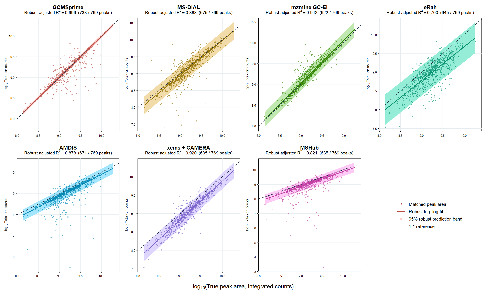
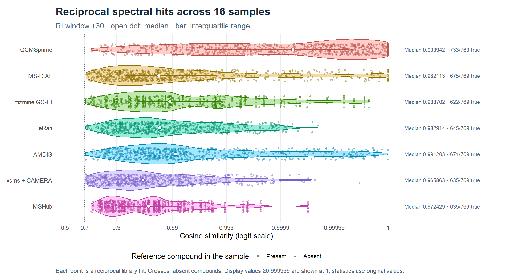
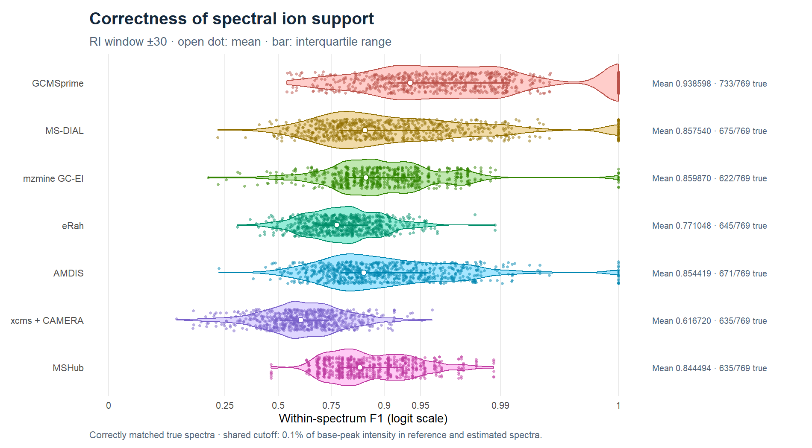
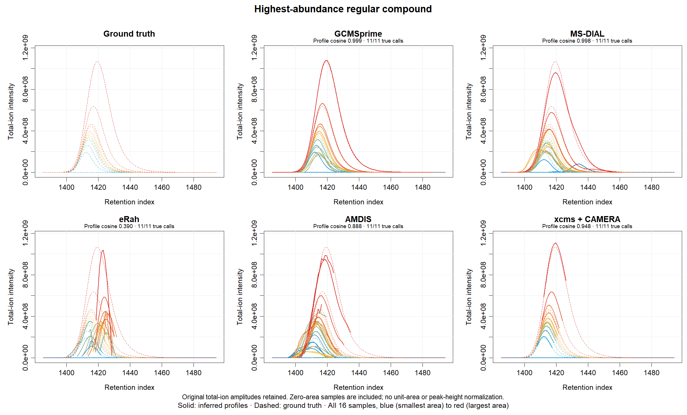
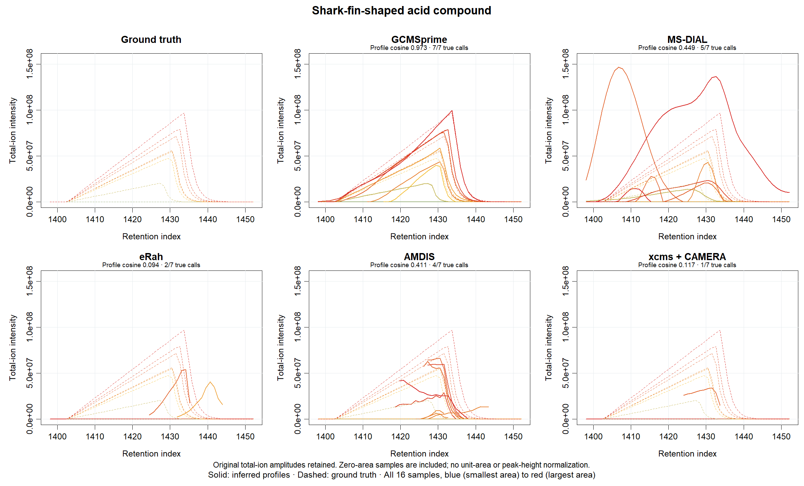
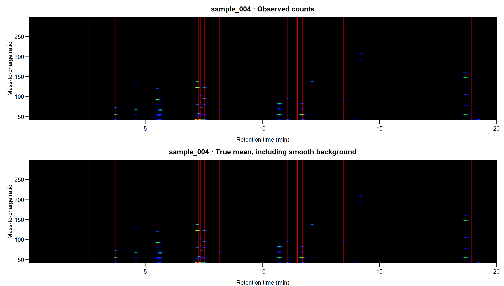
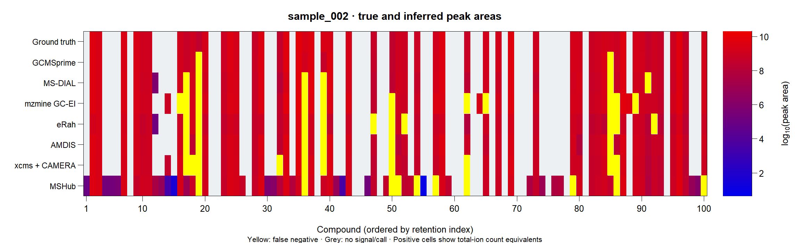

# GCMSbenchmark

Compare GC/MS deconvolution workflows on common ANDI-MS input files.
The package collects timings, component calls, spectra, total-ion area
equivalents and exported elution profiles. Native exports are retained.

## Installation

~~~r
remotes::install_github("tomwenseleers/GCMSprime", subdir="GCMSbenchmark")
library(GCMSbenchmark)
~~~

The [installation guide](INSTALL.md) covers all R packages, external engines
and platform requirements. AMDIS execution requires Windows.

## Benchmark on 16 simulated chromatograms

The **16 chromatograms** share a library of **100 reference compounds**.
Each spans a 20-minute retention window, with 1,200 scans and all 258 mass channels.
Compounds are absent from about half the samples, giving **769 true occurrences**.
Library retention indices determine their positions. One compound has a broad
shark-fin-shaped acid profile; the remaining profiles are exponentially modified
Gaussians. Higher concentrations extend peaks towards later times from
approximately fixed leading edges, and a small positive drift shifts successive
injections to the right.

The smooth B-spline background is derived from the experimental `gcmsData2`
window and contributes 3.03% of the integrated compound signal. The simulation
retains its native abundance scale and uses quasi-Poisson noise with
**dispersion 783.18**, estimated from that window. GCMSprime estimates dispersion
separately in each sample, with a **median estimate of 829.55**. The generating
retention-index maps are used for scoring;
the deconvolution receives neither the known areas nor the true profiles.

| Method | Seconds | TP | FP | Sensitivity | Peak F1 | Ion F1 |
|:--|--:|--:|--:|--:|--:|--:|
| GCMSprime | 157.69 | 733 | 90 | 95.3% | 0.921 | 0.939 |
| MS-DIAL | 17.61 | 675 | 641 | 87.8% | 0.647 | 0.858 |
| mzmine GC-EI | 38.47 | 622 | 70 | 80.9% | 0.851 | 0.860 |
| eRah | 17.07 | 645 | 1912 | 83.9% | 0.388 | 0.771 |
| AMDIS | 92.58 | 671 | 1153 | 87.3% | 0.518 | 0.854 |
| xcms + CAMERA | 24.06 | 635 | 146 | 82.6% | 0.819 | 0.617 |
| MSHub | 20.58 | 635 | 2797 | 82.6% | 0.302 | 0.844 |

Times are wall-clock analysis times on an HP ZBook Fury G8 Mobile
Workstation with an Intel Core i9-11950H at 2.60 GHz, eight physical cores
and 16 logical threads, Windows and R 4.5.0. GCMSprime uses 16
single-threaded sample workers, AMDIS runs serially, and xcms + CAMERA uses
four workers. Input conversion is timed separately.

`ncores` can use any number of available cores. GCMSprime parallelizes
deconvolution across sample workers; when enough samples are available,
the independent fitting time can decrease approximately in proportion to
the worker count. The complete analysis also includes coupled refinement
and data transfers.

[](../GCMSprime/man/figures/simulated-16-area-predictions.png)

All panels use **total-ion count equivalents**. Spectra are normalized to
unit L1 norm, with their magnitude transferred to the corresponding profile
or area. Native model-ion areas are corrected for their ion fraction and
integration-time units. The conversions use each engine's exported factors
and acquisition metadata, without calibration against the known answers.
The native values and conversion factors remain in the result objects.

For a component with profile $h$ and spectrum $s$, let
$c=\sum_j s_j$, $p=s/c$ and $\widetilde h=ch$.
Then $hs^\top=\widetilde h p^\top$ and $\sum_j p_j=1$.
An area measured for a particular ion $q$ becomes
$A_{\mathrm{TIC}}=A_q/p_q$, after converting its integration-time units.

The line is a robust log–log fit using `robustbase::lmrob(setting="KS2014")`.
The shaded 95% prediction band uses its robust residual scale and coefficient
covariance, describing the main approximately Gaussian log-error distribution.
Every observed point remains visible, and the dashed **1:1 reference is drawn
last in every panel**. The headings report robust adjusted R²; ordinary
least-squares statistics are retained in the downloadable tables. GCMSprime
has robust adjusted R² **0.996** and a **median absolute area error of 2.00%**.
Area agreement is conditional on recovered true matches, so it is shown
together with sensitivity and false-positive counts.

[](../GCMSprime/man/figures/simulated-16-spectral-violin.png)

The reference library contains all 100 compounds, including those absent
from an individual sample. Candidate spectra must fall within **30 RI units**
and have cosine similarity of at least **0.70**. A reciprocal pair selects
each other as the best eligible spectral hit. Ties are resolved by RI
difference and then ID. A reciprocal hit to a compound actually present is
a true positive; every other returned component is a false positive.
Additional calls to the same reference compound are included in those counts.
Their areas are not added to the selected match.

[](../GCMSprime/man/figures/simulated-16-spectral-support.png)

Ion support uses a shared **0.1% of base-peak intensity cutoff**, applied
independently to reference and recovered spectra for every method:
$I_j>0$ and $I_j\geq0.001\max_l I_l$.
Within-spectrum $F_1=2TP/(2TP+FP+FN)$ is averaged over correctly matched
true spectra. GCMSprime achieves **mean ion F1 0.939**, compared with
**0.860** for the strongest comparator. Individual points accompany the
violins; the logit-spaced axis retains labels in the original F1 units.

This is also GCMSprime's default spectral reporting cutoff for coefficient
summaries, library queries and MSP/Excel output. `ion_threshold=0` retains
all positive ions. Reporting preserves fitted total ion counts, peak areas,
profiles and information criteria.

## Correctness of inferred elution profiles

[](../GCMSprime/man/figures/simulated-16-regular-profiles.png)

[](../GCMSprime/man/figures/simulated-16-acid-profiles.png)

The first panel set shows the regular compound with the largest total
true area across samples; the second shows the acid compound. All 16 samples
are included and ordered by true abundance, from **blue for the smallest
area to red for the largest**. **Dashed curves are ground truth; solid curves
are returned profiles.** Intensities retain their original total-ion scale,
without unit-area or peak-height normalization. Absent compounds have zero
true signal. Compatible fragments remain separate curves so splitting stays
visible. The generating retention-index calibration supplies the common
horizontal axis; profile amplitudes remain on their native total-ion scale.

GCMSprime recovers these elution profiles most accurately for both the
regular EMG and the shark-fin-shaped acid. Mean profile cosine, counting
missed occurrences as zero, is **0.999 for the regular compound** and
**0.973 for the acid**. Other configurations often truncate profiles,
split their contributions or miss the acid. MS-DIAL also closely recovers
the selected regular compound (mean cosine 0.998). CAMERA supplies a
representative-ion trace scaled to the grouped total-ion area. The mzmine
export here contains spectra and areas without component scan profiles.
MSHub factorizes aligned ion-peak integrals across samples. Its model has
no common compound elution profile constrained to be shared across mass
channels, so component scan profiles are absent from the model itself.
See [Aksenov et al. (2021)](https://pmc.ncbi.nlm.nih.gov/articles/PMC7971188/).

## Signal and peak-area heatmaps

[](../GCMSprime/man/figures/simulated-16-sample-heatmap.png)

[](../GCMSprime/man/figures/simulated-16-area-heatmap.png)

Signal heatmaps use square-root intensity colours. Area heatmaps show total-ion
count equivalents, with bright yellow for missed true occurrences.

## Detection settings

The xcms + CAMERA configuration uses an **8.6-second filter FWHM**,
signal-to-noise threshold **1.5**, a minimum of **four ions**, and CAMERA
FWHM grouping with `perfwhm=0.8`. Eight alternatives were compared on
odd-numbered samples. The selected setting recovered 321 rather than 301
true occurrences there, while keeping peak F1 within 0.01 of the best
candidate. On the even-numbered samples reserved for checking, recovery
increased from 286 to 314 and F1 from 0.773 to 0.803. Across all samples,
sensitivity increased from **76.3% to 82.6%**. No matching or RI thresholds
were relaxed.

### Reproduce the figures or rerun the comparison

The package includes the seeded simulation, engine settings, scoring tables
and plotting code. Recreate the figures from the saved results with:

```r
bench <- system.file("benchmarks", package = "GCMSbenchmark", mustWork = TRUE)
source(file.path(bench, "plot-simulated-16.R"), encoding = "UTF-8")
plotBenchmark16(file.path(bench, "results"), "benchmark-figures")
```

To regenerate the CDFs and run the R workflows:

```r
source(file.path(bench, "simulated-16.R"), encoding = "UTF-8")
fit <- runBenchmark16("benchmark-16", method = c("GCMSprime", "xcms+CAMERA"),
  ncores = 4L)
plotBenchmark16("benchmark-16")
```

For all seven engines, supply their installed locations:

```r
control <- list(
  "MS-DIAL" = list(exe = "C:/tools/MS-DIAL/MSDIALCUI.exe", powershell = "pwsh"),
  mzmine = list(exe = "C:/tools/mzmine/mzmine_console.exe",
    user_file = "C:/path/to/your.mzuser4"),
  AMDIS = list(exe = "C:/tools/AMDIS32/AMDIS_32.exe"),
  MSHub = list(exe = "C:/tools/python/python.exe", source = "C:/tools/mshub_process")
)
fit <- runBenchmark16("benchmark-16-all", method = "all", control = control,
  ncores = 16L)
plotBenchmark16("benchmark-16-all")
```

The run uses seed 9118 and saves truth, the reference library, native engine
exports, per-call identifications and per-pair area/profile metrics. The
reference includes compounds absent from each sample. Their presence is
checked after reciprocal matching. MSHub's aligned RTs use the generating
mean reference clock for RI conversion.

The tested versions are MS-DIAL 5.5.261105, mzmine 4.11.0, eRah 2.2.0,
AMDIS 2.71, xcms 4.6.4, CAMERA 1.64.0 and standalone MSHub revision
`59fe5d5d7ad5`. The MS-DIAL method file and mzmine batch are included.
AMDIS uses component width 16 scans and its local `ONSITE.INI` settings
`SENSIT=60`, `RESOLUTION=0`, `PEAKSHAPE=0`. The xcms + CAMERA detection and grouping settings were compared on odd-numbered
samples and checked on even-numbered samples, as described above.

## Engine setup

| Method | Requirements and controls |
| --- | --- |
| `GCMSprime` | Install GCMSprime and logconNMF. Pass `gcmsDeco()` options such as `precluster`, `baseline_df` and `psf_control` through `...`. |
| `MS-DIAL` | Set `control[["MS-DIAL"]]` to a list with `exe` and optionally `powershell` (PowerShell 7 worked with the Windows console distribution), `method_file` or named `parameters`. The default input is mzML. For direct CDF use `format = "cdf"` and add the official NetCDF runtime through `netcdf` if needed. |
| `mzmine` | Set `control$mzmine$exe` to `mzmine_console.exe` and `user_file` to the existing machine-bound `.mzuser4` file when the CLI requires it. The included mzmine 4.11 batch uses the ADAP-inspired GC-EI workflow and exports its quantification CSV and spectral MGF locally. Supply a different `.mzbatch` with `batch`. |
| `eRah` | Install eRah and optionally future for multiple samples. Use `control$eRah$deconvolution` and `control$eRah$alignment` to set the arguments to `setDecPar()` and `setAlPar()`. |
| `AMDIS` | On Windows, set `control$AMDIS$exe` to `AMDIS_32.exe`. The adapter stages mzXML and runs serially. To rescore existing files, supply one `.ELU` in `control$AMDIS$elu` for each CDF in the same order. |
| `xcms+CAMERA` | Install both Bioconductor packages. xcms detects ion peaks with a matched filter and CAMERA groups them within each sample by coelution and EIC correlation. It returns summed ion integrals, pseudospectra, and representative-ion traces. Use `control[["xcms+CAMERA"]]` to set `detection` (for example `fwhm` in seconds or `snthresh`), `fwhm_grouping` (arguments to `CAMERA::groupFWHM()`), `grouping` (arguments to `CAMERA::groupCorr()`, or `FALSE` for FWHM grouping alone), or `min_ions` (default 3). |
| `MSHub` | For a batch of at least 10 samples, set `control$MSHub$exe` to Python and `source` to the standalone [MSHub repository](https://bitbucket.org/iAnalytica/mshub_process/src/master/). The runtime needs NumPy, SciPy, h5py, scikit-learn and netCDF4. An optional `pythonpath` selects an isolated dependency directory. |

## Supply simulation truth

Each truth record contains `id`, `apex` in minutes, `area` in integrated
counts and a logical `acid` indicator. Supply `H` with scans as rows,
`P` with compounds as rows, and the original `time` and `mass` grids.
Key the records by input-file basename without its extension.

The default `matching="assignment"` maximizes the number of one-to-one
matches within `rt_tolerance` and above `min_cosine`, then total cosine.
For RI-constrained reciprocal scoring, use `matching="reciprocal"` and
`ri_tolerance=30`. Supply a full `reference` library with `id`, `P`, `mass`
and `ri`, plus an increasing `time`/`ri` calibration data frame as
`ri_calibration` in each truth record. Aligned outputs also need
`reference_ri_calibration`. The benchmark retains every call's best
eligible library hit and reciprocal flag in `identifications`.

Profile cosine compares shapes on the original time grid. Robust adjusted
R² comes from a log–log lmrob regression on positive true matches; `area_pairs`
gives its sample size. Duplicate calls are not summed into a matched area.
The summary reports their count alongside total false positives.
