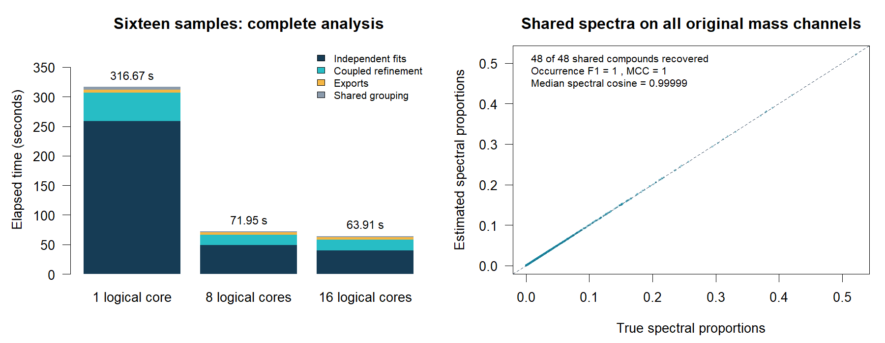
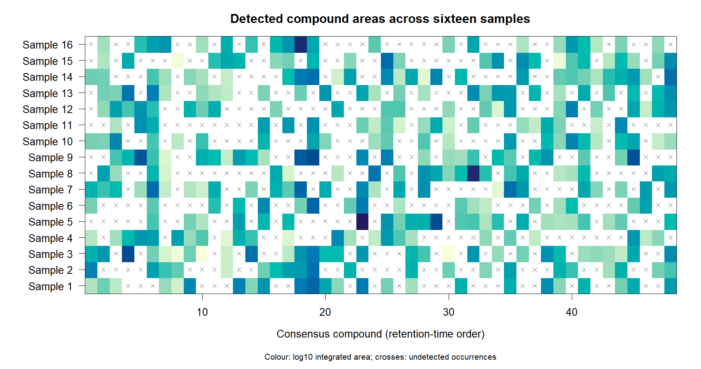
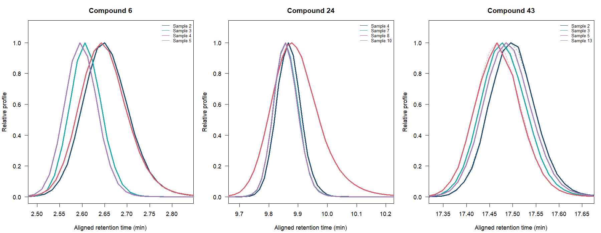
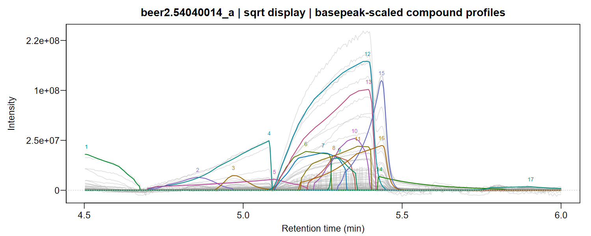

`GCMSdeco()` accepts an experiment directory and analyzes its chromatograms
together. Each sample gets its own time-varying PSF, smooth background and
log-concave compound profiles. Coupled factorization shares mass spectra across
samples and returns one consensus compound library with a sample-by-compound
area table.

## Organize and fit an experiment

```text
chromatograms/
  standards/
    alkanes.cdf
  beer1/
    injection001.cdf
    injection002.cdf
  beer2/
    injection003.cdf
```

```r
library(GCMSprime)

experiment <- GCMSdeco("chromatograms", output_dir="beer_results",
  family=quasipoisson("identity"), precluster=32L,
  batch=list(plots=TRUE))

experiment$samples
experiment$areas
coef(experiment, normalize="l1")
GIC(experiment)
plot(experiment, sample=1L, type="lines", file="sample1_traces.pdf")
```

The `standards` subdirectory is reserved for calibration chromatograms.
Analytical samples are sorted using their acquisition timestamps, including
time-zone information. Group labels come from their relative directories.
Each sample uses the nearest alkane standard in acquisition time. A single
standard can calibrate the whole experiment; `alkanes_file=` explicitly selects
a particular calibration.

For files without acquisition timestamps, supply their relative paths in the
intended run order:

```r
experiment <- GCMSdeco("chromatograms", output_dir="beer_results",
  batch=list(sample_order=c("beer1/injection001.cdf",
                            "beer1/injection002.cdf",
                            "beer2/injection003.cdf")))
```

## Sixteen simulated chromatograms

This example fits 16 chromatograms with 1,200 scans and 258 mass channels
each. The 48 possible compounds occur in roughly half the samples, with
retention drift and concentration-dependent peak widths and tails. All
original ions are retained in the exported spectra. Here the simulated
quasipoisson dispersion is supplied at its known value.

```r
sim <- L0nmf::simulate_GCMS_samples(samples=16L, n=1200L, k=48L,
  preset="time_area", presence=0.5, irregular=0, drift=2,
  family="quasipoisson", dispersion=2, seed=9118)
input <- tempfile("samples16_")
dir.create(input)
for (s in sim$samples) {
  write_GCMS_cdf(s$Y, file.path(input, paste0(s$sample_id, ".cdf")),
    time=s$time, acquired_at=s$acquired_at)
}
rm(sim, s)

experiment <- GCMSdeco(input, output_dir=paste0(input, "_results"),
  family=quasipoisson("identity"), dispersion=2, correlation="none",
  nwindows=2L, baseline_df=4L, precluster=32L, ncores=16L,
  psf_control=list(maxiter=3L),
  batch=list(coupling=list(cycles=2L, initial_cycles=1L, rounds=1L, q=32L)))
experiment$seconds
experiment$areas
plot(experiment, type="areas")
plot(experiment, sample=1L, type="profiles", which=1:6)
```

The fit recovered **all 48 shared compounds and all 380 sample occurrences**,
with no false calls (F1 = 1, MCC = 1). The median cosine similarity to the
true spectra was **0.999994**. Matching for this assessment used aligned apex
times within 0.15 minutes and spectral cosine similarity of at least 0.9.
The GIC was 9,832,385.06 at all three core budgets, with equal spectra, areas
and accepted fusion steps. Median adjusted weighted R² was 0.920.

| Logical cores | Shared grouping | Independent fits | Coupled refinement | Exports and other work | Total |
|--:|--:|--:|--:|--:|--:|
| 1 | 5.03 s | 258.74 s | 48.01 s | 4.89 s | 316.67 s |
| 8 | 1.42 s | 49.00 s | 17.47 s | 4.06 s | 71.95 s |
| 16 | 1.38 s | 40.11 s | 18.07 s | 4.35 s | **63.91 s** |

The complete workflow ran **5.0 times as fast** with 16 workers as with one. Timings
include automatic PSF estimation, deconvolution, alignment, coupling and
exports on an HP ZBook Fury G8 with an Intel Core i9-11950H (8 physical cores,
16 logical cores), R 4.5.0 and OpenBLAS. Each sample worker used one native
thread. The [benchmark script](https://github.com/tomwenseleers/GCMSprime/blob/master/benchmarks/16_samples_parallel.R)
recreates the chromatograms and evaluates the recovered compounds.







## Outputs and memory use

The output directory contains:

* `samples.csv`: acquisition order, group, calibration file and sample result paths.
* `areas.csv`: integrated compound areas; undetected occurrences have `NA`.
* `consensus.msp`: the common spectral library, with every positive fitted ion.
* `experiment.xlsx`: sample information, consensus compounds, packed spectra and areas.
* `experiment.rds`: the experiment object.
* `samples/<sample_id>/`: fitted sample RDS, NIST-compatible MSP and Excel results,
  plus trace and heatmap PDFs when `batch$plots=TRUE`.

Spectral text cells are unwrapped and list fragments by decreasing intensity.
Sample objects retain factor matrices and CDF paths. Plots reload the required
observations. Coupled fitting stores original observations and large
weight/offset arrays on disk. It caches the common aggregate channels in RAM
and streams bounded blocks of original channels for likelihood and spectral
updates. At 10,000 scans and 32 groups, the aggregate cache occupies 2.56 MB
per sample, or 2.56 GB for 1,000 samples. Factors and active workers need
additional memory. Set `batch=list(cache=FALSE)` to read the aggregate data
from disk as needed. Use `batch=list(workers=4L)` to cap the number of
concurrent samples within the `ncores` budget.

The same ion groups are used across samples for matching. They are learned
from a pooled, time-binned chromatogram or supplied through `precluster` as
a saved [channel map](https://tomwenseleers.github.io/L0nmf/reference/channel_groups.html),
for example one trained on reference spectra. Each sample's PSF and scan grid
remain separate.

```r
sample1 <- readRDS(experiment$paths[1L])
sample1$compounds
plot(sample1, type="profiles", file="sample1_profiles_spectra.pdf")
fitted(experiment, sample=1L)
```

The [coupled NMF tutorial](https://tomwenseleers.github.io/L0nmf/articles/coupled-nmf.html)
gives the mathematical model, alignment, spectral grouping, local updates and
simulation results. Its validation includes three samples with all 258 mass
channels, differing scan grids, concentration-dependent tails and compounds
absent from half the samples. All seven signal noise families are supported.

## Scan spacing and exposure

Observed matrices stay on their native scan grids. Monotone alignment changes
profile coordinates and bin widths; its Jacobian preserves integrated peak
areas. The model is evaluated directly at the original scan times.

By default, GCMSprime models the vendor's exported intensities with unit
exposure. Quadrupole acquisition distributes scan time across the mass range.
The effective time per mass also depends on scan step size, scan averaging and
acquisition settings; see the [Agilent method documentation](https://openlab.help.agilent.com/en/mergedProjects/GCMSHelp/MEAcquiUI.htm).
ANDI files can contain arbitrary abundance units, so scan duration and the
number of exported mass peaks alone do not identify physical count exposure.

If integrated counts and their durations are known, supply exposure explicitly:

```r
experiment <- GCMSdeco("chromatograms", output_dir="count_results",
  family=poisson("identity"),
  batch=list(exposure=function(metadata, time) metadata$scan_duration))
```

Here `scan_duration` is appropriate only when it represents the integration
duration of each reported count. A calibrated per-mass duration can instead be
returned by the function. Metadata vectors are restricted to the fitted scans.
With an identity link, exposure multiplies the latent mean. It is incorporated
into profile and background design values during fitting.

## Calibrated beer example

An alkane ladder can supply the peak shapes for every sample in the batch.
Use its total-ion chromatogram (TIC) after the solvent peak, and reuse that
calibration on each sample's own scan grid. The full ladder spectra provide
the diagnostic ions for RI calibration. The two calibrations serve different
purposes: the TIC describes narrow peak shapes, while the fragment and
molecular ions identify the retention-index anchors.

```r
# Read the standard's TIC and ANDI-MS scan times (seconds in these files).
standard <- "chromatograms/standards/alkanes.cdf"
nc <- ncdf4::nc_open(standard)
tic <- ncdf4::ncvar_get(nc, "total_intensity")
time <- ncdf4::ncvar_get(nc, "scan_acquisition_time") / 60
ncdf4::nc_close(nc)
keep <- time >= 3
psf <- estimate_psf(tic[keep], time=time[keep], method="standard", nwindows=10L)

experiment <- GCMSdeco("chromatograms", output_dir="beer_results",
  alkanes_file=standard, precluster=32L, ncores=16L,
  psf_control=list(standard=psf, method="standard"))
cal <- calibrate_ri(standard, carbon=7:23, psf=psf)
experiment <- annotate_ri(experiment, cal, phase="DB5",
  msp_file="beer_results/consensus.msp", xlsx_file="beer_results/experiment.xlsx")
```

The retention coordinate is the 1%-height onset plus half the local
narrow-peak width measured at the same height. The natural cubic RI spline
passes through the alkane anchors exactly. The sample MSPs contain
phase-labelled indices, and the consensus MSP contains their medians.

A separate run on the 4.5–6 minute window uses two PSF windows, 32 outcome
groups, all 518 original channels and eight logical cores. It links
**31 detected occurrences into 29 consensus compounds**.
Adjusted weighted R² is **0.995** and
**0.996** for the two samples. The directory run
reports **42.14 s** including its exports.



With the solvent-trimmed ladder TIC supplying the time-varying PSF, the complete
chromatograms retain all 518 mass channels and link **746 detected occurrences
into 614 consensus compounds**:

| Sample | Detected occurrences | Adjusted weighted R² | Sample GIC | Independent fit |
|:--|--:|--:|--:|--:|
| 502131900304_a | 388 | 0.9895 | 16,338,999 | 1,287.35 s |
| 54040014_a | 358 | 0.9885 | 16,495,671 | 848.43 s |

The shared TIC calibration took 1.58 s, and constructing each sample's sparse
PSF took about 1.6 s. The two independent fits ran concurrently with eight
native threads per worker. The directory workflow took 1,754.67 s (29.2 minutes), including
1,291.91 s for independent fits and 449.35 s for coupled refinement. The joint
GIC is 31,335,633; it counts common spectra once and amplitudes separately for
each detected occurrence. Sample GIC values in the table are evaluated after
coupling and count the spectra separately for each sample. RI annotation uses
all 17 alkanes from C7 to C23, with the fitted curve passing through every
anchor. The directory workflow plus RI annotation took 1,759.58 s.
These figures exclude separately generated diagnostic plots.

The fitted components can be inspected sample by sample, and common spectra
can be searched against a library with each sample's alkane-derived retention
indices. Pass `library=` and `search=` to `GCMSdeco()` to include those
identifications in the per-sample MSP and Excel exports.

Set `coupled=FALSE` to export independent fits. Set `batch=list(resume=TRUE)`
to reuse independently fitted samples whose source-file metadata and fitting
settings match the cache. Coupled refinement is then computed from those fits.

See [GCMSbatch](../reference/GCMSbatch.html) for options and
[single-sample deconvolution](gcms-deconvolution.html) for diagnostic plots,
profile fitting and spectral recovery.
