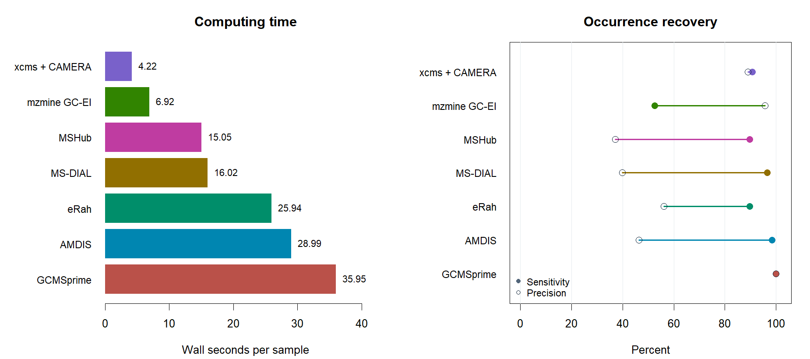
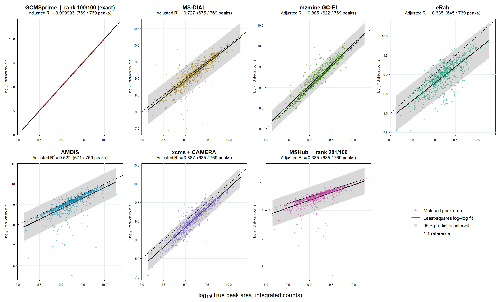
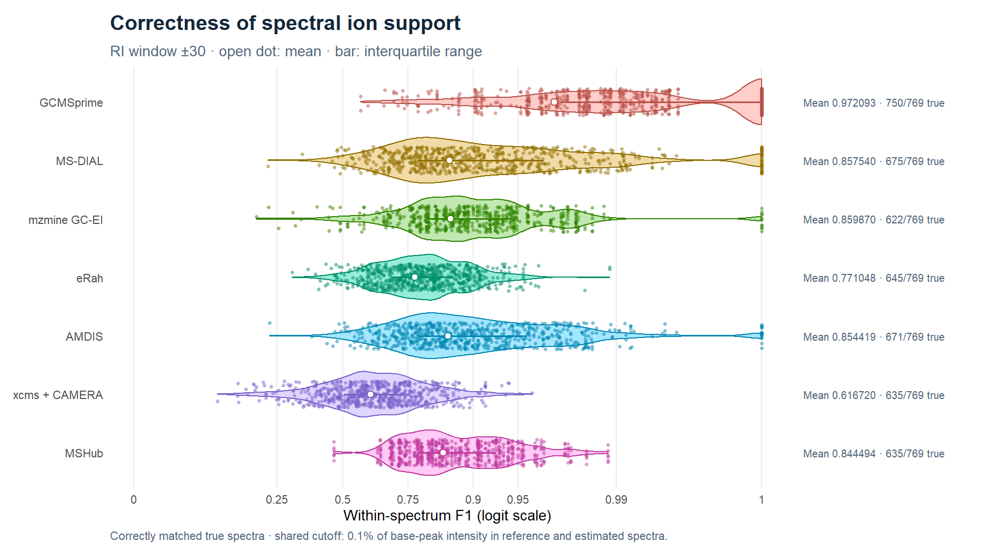
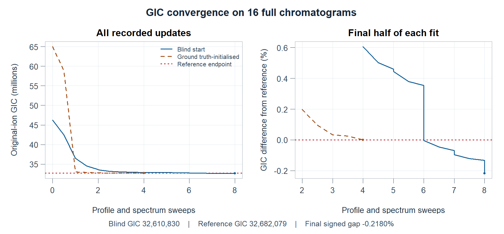
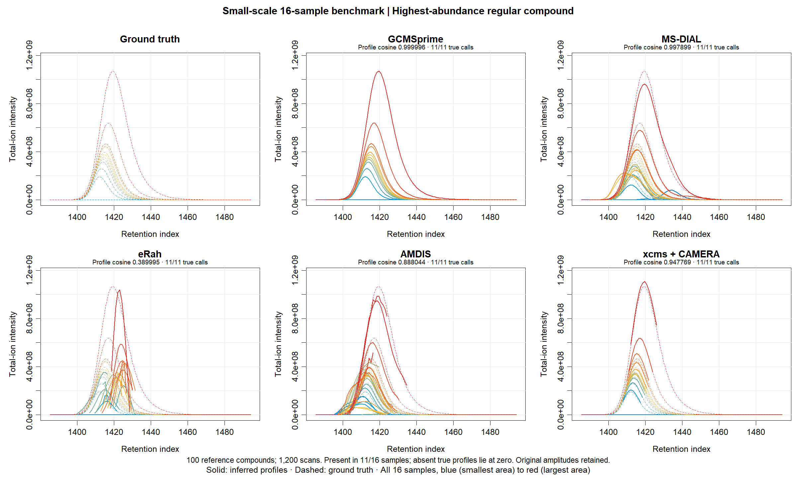
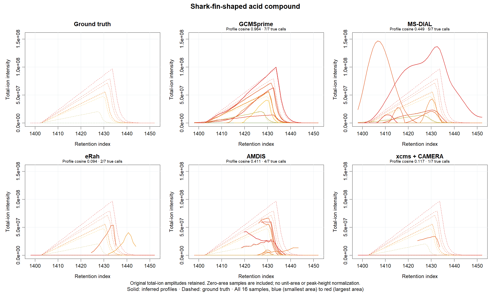

# GCMSprime: Scalable Automated GC–MS Deconvolution, Quantification and Spectral Library Search in R

<a href="https://tomwenseleers.github.io/GCMSprime/">
<picture>
  <source media="(prefers-color-scheme: dark)" srcset="GCMSprime/man/figures/logo-dark.svg">
  <source media="(prefers-color-scheme: light)" srcset="GCMSprime/man/figures/logo-light.svg">
  
</picture>
</a>

[Get started](https://tomwenseleers.github.io/GCMSprime/articles/gcms-deconvolution.html) · [Documentation](https://tomwenseleers.github.io/GCMSprime/reference/index.html) · [Algorithm & theory](https://tomwenseleers.github.io/GCMSprime/articles/algorithm.html)

A GC–MS run records mixtures of ions whenever compounds overlap in time.
GCMSprime separates these signals into elution profiles and full mass spectra,
then integrates each resolved compound. It accepts ANDI-MS CDF files and
writes an MSP library of the recovered spectra and an Excel quantification
table when requested. For a sample series, it aligns retention times and
shares spectra across related occurrences.

An alkane ladder can calibrate peak shapes and retention indices. Supplying a
spectral library adds ranked candidate matches, with the retention-index
agreement and the reference source recorded alongside each score.

## Installation

```r
install.packages("remotes")
remotes::install_github(c(
  "tomwenseleers/L0glm/L0glm",
  "tomwenseleers/logconNMF/logconNMF",
  "tomwenseleers/GCMSprime/GCMSprime"
))
```

The R package includes the conditional Poisson and quasi-Poisson solver. It fits the original ion counts with compiled C++ kernels and uses OpenMP when available. Solver selection is automatic for the requested noise model and memory settings.

## Automatic deconvolution for single samples

One call estimates the response shape, smooth background, compound profiles,
full mass spectra and integrated areas, then writes NIST-compatible MSP and
Excel reports. An alkane ladder can calibrate the PSF and retention indices.

```r
library(GCMSprime)
fit <- gcmsDeco("sample.cdf", "sample.msp", xlsx_file="sample.xlsx",
  alkanes_file="alkanes.cdf", precluster=32L)
plot(fit, type="lines", file="sample_traces.pdf")
plot(fit, type="heatmap", file="sample_heatmaps.pdf")
plot(fit, type="profiles", file="sample_profiles_spectra.pdf")
```

The compound table gives apex retention times, integrated areas and the
number of fitted ions. Use the trace and heatmap plots to inspect overlapping
peaks and residual structure, and use the profile and spectrum plots to
inspect individual components.

```r
head(fit$compounds[c("compound", "retention_time", "area", "n_ions")])
fit$seconds
spectra <- coef(fit, normalize="l1")  # unit-L1 spectra, shared 0.1% ion cutoff
```

The fit allows asymmetric and broad profiles under a hard log-concavity
constraint. The rank criterion selects the component set, and final
refinement uses every original mass channel.

For full chromatograms, Cholesky initialization automatically retries with
diagonally preconditioned conjugate gradients if it exceeds L0glm's workspace
budget. The switch is reported and retains the memory limit and selection
settings. To request the iterative solver directly, use:

```r
fit <- gcmsDeco("sample.cdf", "sample.msp", alkanes_file="alkanes.cdf",
  control=list(initial_solver=list(solver="eigen", method=3L, precond=1L)))
```

The `initial_solver` list accepts `L0glm::controlSolverGen()` arguments,
including `max.memory` in GiB. Set `initial_fallback=FALSE` in `control` to
require the chosen solver. These controls require GCMSprime and logconNMF
0.1.0.9003 or later.

For a sample series with limited RAM, the same controls apply to each sample.
Use one sample worker and disable observation caches to reduce concurrent
working memory while retaining coupled refinement:

```r
experiment <- gcmsDeco("chromatograms", output_dir="results", ncores=8L,
  control=list(initial_solver=list(solver="eigen", method=3L, precond=1L)),
  batch=list(workers=1L, cache=FALSE))
```

In this disk-backed fit, one sample is active at a time and can use up to eight native threads. The conditional count solver shares the original counts in RAM during its joint fit. Use `ncores=1L` to run the entire conditional workflow serially.

`max.memory` limits the solver's Gram/factor workspace, not total process RAM.
The observed data, profiles and refinement buffers still need to fit in memory
for each active sample.

### Six co-eluting hydrocarbons

The bundled cuticular-hydrocarbon window illustrates recovered elution profiles
and spectra. This short-window example uses a supplied PSF dictionary and a
constant background; individual compound shapes are then refined.

```r
data(gcmsData1, package="logconNMF")
writeGCMSCDF(gcmsData1, "GCMS_data1.cdf")
example_fit <- gcmsDeco("GCMS_data1.cdf", "GCMS_data1.msp",
  nwindows=1L, baseline_df=1L, precluster=7L, correlation="auto", ncores=8L,
  control=list(initial_relaxed=FALSE, fusion_passes=0L),
  psf_control=list(kernel_est=logconNMF::convKernel("gaussian", 65L,
    list(sigma=9)), maxiter=0L))
```

Among six-factor solutions with chemically plausible retention times, a
sensitivity grid over PSF widths and precluster counts selected this fit for
its combination of low GIC, accurate apex times, compact profiles and strong
enrichment of the compounds' diagnostic ions.

[](https://tomwenseleers.github.io/GCMSprime/articles/gcms-deconvolution.html#cuticular-hydrocarbons)

### Beer volatiles and a broad acid peak

A beer-headspace window contains a strongly asymmetric acid peak mixed with
narrower neighbours. Flexible log-concave profiles accommodate this shape while
the spectra use all 518 channels. The same workflow represents the broad acid
contribution as one log-concave profile among the narrower peaks. The
single-sample tutorial reports the measured CDF-to-MSP times and fit metrics.

[](https://tomwenseleers.github.io/GCMSprime/articles/gcms-deconvolution.html#beer-volatiles-and-a-broad-acid-peak)

The [single-sample tutorial](https://tomwenseleers.github.io/GCMSprime/articles/gcms-deconvolution.html) includes both
datasets, fitted-signal heatmaps, profile/spectrum panels, timings and downloadable
MSP/PDF outputs. [GC/MS deconvolution: mathematical basis](https://tomwenseleers.github.io/GCMSprime/articles/algorithm.html)
explains the progression from known PSFs to estimated and component-specific shapes.

## Automatic deconvolution for multiple samples

Point to a directory containing sample-group folders and a `standards/`
subdirectory with alkane calibrations. Acquisition timestamps determine run
order. The simultaneous model aligns compounds and shares their spectra while
retaining sample-specific profiles, backgrounds and areas.

```r
experiment <- gcmsDeco("chromatograms", output_dir="experiment_results",
  precluster=32L, batch=list(plots=TRUE))
experiment$samples
experiment$areas
```

Grouped PSF regressions divide the core budget between independent samples and native threads. The scheduler estimates how many regressions fit in available memory, including Windows commit headroom. After those workers exit, a single process shares the original ion counts and fitted means. OpenMP updates elution profiles across samples. It fits each ion’s shared spectrum and sample-specific background coefficients independently, keeping a fixed component order within each ion. The general identity-link solver can stream original-channel blocks from disk.

## Benchmarks against other software

The same 16 simulated chromatograms were supplied to every program. Each contains **10,000 scans × 550 nominal mass channels** (m/z 30–579), covering approximately 50 minutes. Together they contain **88 million simulated ion intensities**. Each of the **1,000 distinct compounds** occurs in eight randomly chosen samples. The design therefore contains **8,000 positive sample–compound pairs**. Rank here counts the distinct generating compounds across the batch, each with a time-local elution profile in each positive sample. Of the compounds, 990 have exponentially modified Gaussian (EMG) peaks and ten have a rising shark-fin profile with an abrupt trailing edge. Higher concentrations broaden both types. The acquisition clock allows a smooth retention shift of up to 2.93 seconds between the first and last injections and approximately 2% variation in scan spacing.

GCMSprime, using simultaneous logconNMF, **recovered the true rank of 1,000 exactly** in **35.95 seconds per sample**. It recovered **8,000 of 8,000** compound occurrences and made **no false-positive calls**. The recovered peaks included **80 of the 80 acid occurrences**. MSHub returned **1,414 deconvolved components**, 41.4% above the true rank. The other five workflows produce peak lists or aligned feature groups. Their outputs do not define a common factorisation rank.

The 1,000 shared factors matched the 1,000 generating compounds one-to-one across all eight occurrences of each compound. This is exact automatic recovery of the chemical component count from 550 measured ion channels. Scan order distinguishes compounds that elute at different times, and each compound contributes a shared spectrum wherever it occurs.

The largest exact rank recovery we found in a published benchmark of conventional NMF with added noise was **150 factors**. Squires, Prügel-Bennett and Niranjan selected that rank on a 1,000 × 2,000 matrix using minimum description length. They also recovered 50, 80 and 120 factors exactly. The 16 full chromatograms here contain **88 million ion measurements**, compared with **2 million matrix entries** in their rank-150 example. The simultaneous fit recovered **6.7 times** as many generating components from **44 times** as many observations. [Squires et al., Figs. 1–2](https://doi.org/10.1162/NECO_a_00980)

Eswar et al. compared rank selectors on simulated matrices with true rank 10, testing candidate ranks from 1 to 20. Under Gaussian noise only cross-validation and singular-value hard thresholding ever recovered the planted rank in their experiment. Cai et al.’s Poisson NMF benchmark rarely extended beyond rank 10, with just one higher rank (30) among the six they tested. [Eswar et al.](https://doi.org/10.1109/BigData62323.2024.10825324) · [Cai et al.](https://doi.org/10.1002/sim.9934)

Chennupati et al. recovered seven planted factors in a one-terabyte matrix using distributed NMF. Fu et al. tested nonnegative tensor rank selection at true ranks 15–40. [Chennupati et al.](https://doi.org/10.1007/s11227-020-03181-6) · [Fu et al.](https://doi.org/10.3390/e21070632) · [Evidence for automatic rank recovery](https://tomwenseleers.github.io/GCMSprime/articles/benchmarks.html#evidence-for-automatic-rank-recovery)

Fitting the 88 million observations took **35.95 seconds per sample** on a 64 GB laptop with 16 logical processors. The sampled peak working set was **6.8 GiB**. [Measured scalability](https://tomwenseleers.github.io/GCMSprime/articles/benchmarks.html#measured-scalability)

| Workflow | Seconds/sample | Estimated rank (true 1,000) | TP (sensitivity) | FP | FN | Acid TP / 80 |
| --- | ---: | ---: | ---: | ---: | ---: | ---: |
| GCMSprime | 35.95 | **1,000 (exact)** | 8,000 (100%) | 0 | 0 | 80 / 80 |
| MS-DIAL | 16.02 | — | 7,728 (96.6%) | 11,685 | 272 | 73 / 80 |
| mzmine GC-EI | 6.92 | — | 4,202 (52.5%) | 185 | 3,798 | 29 / 80 |
| eRah | 25.94 | — | 7,172 (89.7%) | 5,615 | 828 | 70 / 80 |
| AMDIS | 28.99 | — | 7,878 (98.5%) | 9,122 | 122 | 80 / 80 |
| xcms + CAMERA | 4.22 | — | 7,261 (90.8%) | 890 | 739 | 31 / 80 |
| MSHub | 15.05 | 1,414 | 7,179 (89.7%) | 12,184 | 821 | 50 / 80 |

Among GCMSprime’s 8,000 matched occurrences, the median absolute relative area error was **0.095%** and ordinary adjusted R² on the log₁₀ scale was **0.999982**.

[](GCMSprime/man/figures/simulated-16-performance.png)

[](GCMSprime/man/figures/simulated-16-area-predictions.png)

[](GCMSprime/man/figures/simulated-16-spectral-violin.png)

[](GCMSprime/man/figures/simulated-16-spectral-support.png)

<span id="optimality-gap-to-ground-truth-initialised-solution"></span>

### Convergence behaviour

The blind fit converged to a solution very close to the simulated ground truth. It recovered **all 1,000 compounds and all 8,000 peak occurrences**, with a median elution-profile cosine of **0.999994** and a median absolute relative area error of **0.095%**. GIC showed smooth, monotonic descent over eight sweeps. Its final value differed by only **0.19%** from that of a fit initialised with the true elution profiles and run for the same eight sweeps.

[](GCMSprime/man/figures/full-benchmark-gic-gap.png)

[Block-level GIC trace](https://github.com/tomwenseleers/GCMSprime/blob/master/GCMSbenchmark/inst/benchmarks/results/gic-trace.csv) · [Final GIC values](https://github.com/tomwenseleers/GCMSprime/blob/master/GCMSbenchmark/inst/benchmarks/results/gic-gap.csv).

### Elution profile recovery

The examples are the EMG compound and the acid with the greatest total true area in their respective classes. Both were selected from the simulation before comparing any fits. Each occurs in eight samples. Solid curves show inferred profiles, dashed curves show the true profiles, and the eight absent true profiles coincide at zero. Colours order the 16 samples by true area. Heights retain original total-ion intensity per scan. The mean cosine in each example uses all eight positive occurrences, with a missing recovered profile scoring zero. The all-acid tally covers all ten acids.

[](GCMSprime/man/figures/simulated-16-regular-profiles.png)

[](GCMSprime/man/figures/simulated-16-acid-profiles.png)

[Benchmark methods, scoring, timings and reproduction code](https://tomwenseleers.github.io/GCMSprime/articles/benchmarks.html).

## Comparison with other software

Of the seven workflows run on the same 16 full chromatograms, **GCMSprime alone recovered the true rank of 1,000 and all 8,000 peaks, with 100% sensitivity and zero false positives**. Rank counts distinct compounds present in at least one sample. Each fitted compound matched one simulated compound across all eight samples where it occurred. GCMSprime also gave the most accurate peak areas, with **adjusted R² = 0.999982** for estimated versus true log₁₀ areas and a **median absolute relative error of 0.095%**. The next-highest adjusted R² was 0.966560 for mzmine GC-EI, on its 4,202 matched peaks.

GNPS/MSHub was the only other tested workflow to report a batch component count. It estimated **1,414 components** (41.4% above the true rank), missed 821 occurrences and made **12,184 false-positive peak calls**. The five workflows that deconvolved or grouped peaks per sample achieved **52.5–98.5% sensitivity** and made **185–11,685 false-positive calls** each. Even AMDIS, the closest on sensitivity, missed 122 peaks and made 9,122 false-positive calls. Peak widths, detection thresholds and ion-grouping settings are among the choices that affect these results. [Benchmark counts, scoring and settings](https://tomwenseleers.github.io/GCMSprime/articles/benchmarks.html#comparison-with-other-software)

### Matrix and tensor factorisation approaches

GCMSprime uses grouped L₀ regression to select candidate peaks jointly across mass channels. It then scores changes to the shared compound count on the original ion data. Its quasi-Poisson GIC charges for the complexity of each log-concave elution profile and the number of free positive ion proportions in each spectrum. An additional compound or fragment ion must improve the fit enough to justify its cost. This gives an explicit selection rule for spectral sparsity. [Mathematical description](https://tomwenseleers.github.io/logconNMF/articles/algorithm.html#conditional-count-objective)

| Matrix or tensor method | How rank enters the fit | Limitation for these chromatograms |
|:--|:--|:--|
| **MCR-ALS, conventional GC–MS NMF and unimodal NMF** | The analyst supplies the component count, often after an exploratory analysis. | Nonnegativity allows multiple maxima within a profile. Unimodality rules those out but still allows irregular shoulders and tails. [MCR-ALS](https://doi.org/10.6028/jres.124.018) · [GC–MS NMF](https://doi.org/10.1016/j.talanta.2004.09.017) · [Unimodal NMF](https://doi.org/10.1109/ICASSP39728.2021.9414631) |
| **Simultaneous NMF** | A common factor links datasets at a specified rank. | Sharing spectra helps across samples. The basic factorisation leaves each compound’s elution shape unrestricted and supplies no chromatographic rule to choose between one broad peak and two neighbouring factors. [Lee et al.](https://doi.org/10.1371/journal.pone.0048238) |
| **Global parametric GC–MS analysis** | Candidate compound models are specified and fitted jointly. | The chosen peak family must describe the peaks in every sample. A good exponentially modified Gaussian model for a regular peak can leave a systematic residual at the sharp trailing edge of a shark-fin acid. [Van Stokkum et al.](https://doi.org/10.1016/j.chemolab.2008.10.004) |
| **PARAFAC and shifted PARAFAC** | Diagnostics such as core consistency compare specified ranks. | Standard trilinearity fixes each compound’s elution shape across samples up to amplitude. Allowing a retention shift moves the peak, while its width and asymmetry remain fixed. The simulated peaks broaden with concentration. [Shifted factor models](https://three-mode.leidenuniv.nl/pdf/h/harshmanhonglundy2003i.pdf) · [Core consistency](https://doi.org/10.1002/cem.801) |
| **Classical PARAFAC2 and PARADISe** | PARADISe compares candidate ranks within retention intervals. A later automated workflow also selects and evaluates models. | PARAFAC2 lets profiles move, but their cross-products after scaling must agree across samples. Differential broadening changes how much neighbouring peaks overlap and can violate that condition. Choosing an interval model also leaves the task of assigning unique compounds across the chromatogram. [PARADISe](https://doi.org/10.1016/j.chroma.2017.04.052) · [Automated PARADISe](https://doi.org/10.1016/j.trac.2021.116451) |
| **Flexible and fully constrained PARAFAC2** | Both cited formulations fit a specified number of components. | Flexible coupling relaxes the cross-product condition. AO-ADMM can impose sparsity, smoothness or nonnegativity on all modes. The analyst still specifies the rank and relevant regularisation settings in these least-squares fits. [Cohen and Bro](https://doi.org/10.1007/978-3-319-93764-9_9) · [Roald et al.](https://doi.org/10.1137/21M1450033) |
| **Shift-invariant trilinearity and PARAFAC2×N** | Both fit a chosen model order. | A shifted copy of a common peak cannot reproduce concentration-dependent broadening. PARAFAC2×N accommodates drift in multiple separation dimensions. Its coupling constraints still leave the number of compounds to be selected. [Shift-invariant trilinearity](https://doi.org/10.1002/cem.3501) · [PARAFAC2×N](https://doi.org/10.1016/j.aca.2023.340909) |

The distinction matters for the simulated ion counts, whose variance rises with their mean. Unweighted least squares treats a residual of a given size equally at all intensities. Poisson MCR and KL-based NMF accommodate signal-dependent noise. GCMSprime also estimates overdispersion, which sets the scale of a deviance improvement relative to the cost of extra ions or compounds. The methods above have useful extensions for noise, sparsity and rank selection. Their cited formulations do not combine grouped peak selection across ions, penalisation of spectral support and per-occurrence log-concavity in a whole-chromatogram rank criterion. [Poisson MCR](https://doi.org/10.1016/j.chemolab.2016.02.006) · [NMF objectives](https://doi.org/10.1002/9780470747278)

### Commercial GC–MS software

The vendor guides reviewed here do not specify a preset objective for deciding whether a better fit to the original ion counts justifies another compound, a more complex profile or additional fragment ions. Users can set peak width, height, area and signal-to-noise thresholds in AnalyzerPro. In MassHunter, the correlation window affects how many neighbouring peaks are resolved. These choices can change the peak list. The nine commercial workflows reviewed have no published result on these 16 chromatograms against which to compare rank recovery, false calls or area accuracy. [AnalyzerPro](https://spectralworks.com/2016/07/08/using-analyzerpro-in-the-metabolomics-workflow/) · [MassHunter, p. 27](https://www.agilent.com/cs/library/usermanuals/public/G3335-90243_Unknowns_Analysis_Familiarization-en.pdf#page=27) · [Commercial software comparison](https://tomwenseleers.github.io/GCMSprime/articles/benchmarks.html#commercial-gcms-deconvolution-software)

## Spectral library search

**Open and commercial libraries can be imported.** MoNA and Golm MSP collections,
GCMS-ID CSV predictions, and OpenChrom-exported Agilent or Shimadzu libraries
are supported. Large catalogues can remain in indexed SQLite storage.

```r
lib <- readMSP("library.msp", backend="sqlite", db_file="library.sqlite")
identified <- gcmsDeco("sample.cdf", "identified.msp",
  xlsx_file="identified.xlsx", alkanes_file="alkanes.cdf", library=lib,
  search=list(phase="DB5", ri_tolerance=30, n_matches=5,
              method=c("stein_scott", "hellinger")))
```

The compounds recovered from single- or multisample deconvolution can be
automatically annotated using **spectral match quality and retention index**.
Alkane-derived indices first restrict candidates to the selected column class
and tolerance; fast native search then ranks their spectra. Multisample
consensus IDs support a unique-compound list across the experiment, with
sample-specific RI evidence and full match provenance retained.

Stein–Scott, cosine/angular, Hellinger and symmetric probability/count
comparisons are available, with optional ion-rarity weighting. Excel and MSP
reports include the ranked matches and annotations. The
[library-import tutorial](https://tomwenseleers.github.io/GCMSprime/articles/spectral-libraries.html) covers formats and
storage; [retention indices and library search](https://tomwenseleers.github.io/GCMSprime/articles/library-search.html)
shows single- and multisample identification. The
[identification theory](https://tomwenseleers.github.io/GCMSprime/articles/identification-theory.html) gives the formulas,
calibration and comparison benchmarks.


## Selected references

- Lu et al. (2008) tested how concentration and component-width settings affected GC–TOF-MS deconvolution with AnalyzerPro, ChromaTOF and AMDIS. [Comparative evaluation](https://doi.org/10.1016/j.trac.2007.11.004)
- Camp (2019) describes how alternating regression lets analysts choose constraints separately for concentrations and spectra. [pyMCR](https://doi.org/10.6028/jres.124.018)
- Lee et al. (2012) fit a common factor across multiple datasets. [Simultaneous NMF](https://doi.org/10.1371/journal.pone.0048238)
- Johnsen et al. (2017) describe PARADISe for GC–MS. Baccolo et al. (2021) automated its model selection and assessment. Roald et al. (2022) show how to constrain all modes of PARAFAC2. [PARADISe](https://doi.org/10.1016/j.chroma.2017.04.052) · [Automated PARADISe](https://doi.org/10.1016/j.trac.2021.116451) · [Constrained PARAFAC2](https://doi.org/10.1137/21M1450033)
- Aksenov et al. (2021) describe the GNPS/MSHub workflow. [MSHub](https://doi.org/10.1038/s41587-020-0700-3)
- Chennupati et al. (2020) infer the number of factors in large matrices. Fu, Matsushima and Yamanishi (2019) compare rank-selection criteria for nonnegative tensors. [Distributed NMF](https://doi.org/10.1007/s11227-020-03181-6) · [Tensor rank selection](https://doi.org/10.3390/e21070632)

## Citation

An article describing the methods implemented in GCMSprime is in preparation.
To cite the installed version, use `citation("GCMSprime")` in R. GitHub also
provides a citation under **Cite this repository**.

The [Authors and Citation page](https://tomwenseleers.github.io/GCMSprime/authors.html#citation) also provides the
citation in BibTeX format. Please also cite the methodological sources linked
in the help pages where relevant.

## Acknowledgements

OpenAI Codex, using GPT-6 Astra and GPT-6.1 Sol, was used to optimize and
refactor code and help draft the documentation. The key ideas and methodological
decisions are the authors' own, and the authors take full responsibility for the
work presented here.
