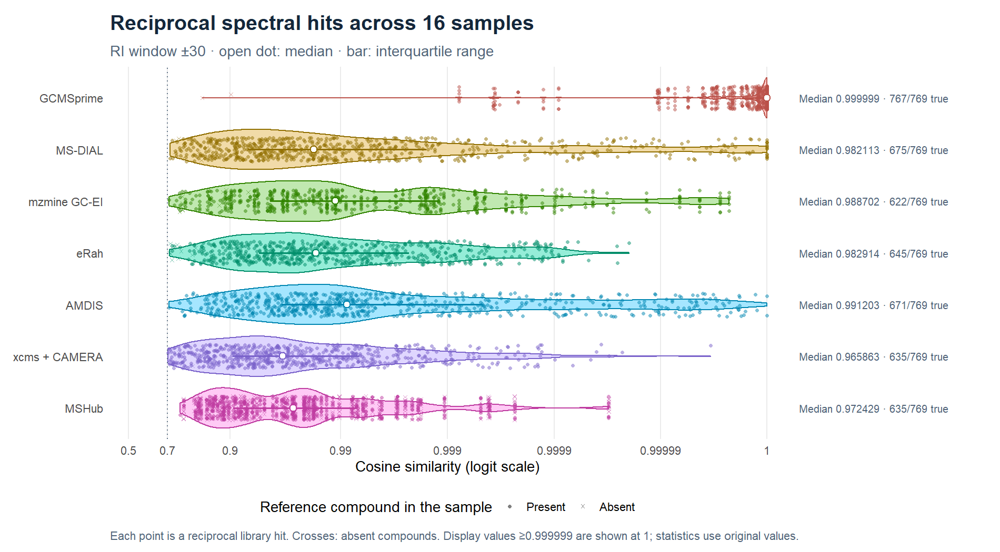

# GCMSprime: Scalable Automated GC–MS Deconvolution, Quantification and Spectral Library Search in R

<a href="https://tomwenseleers.github.io/GCMSprime/">
<picture>
  <source media="(prefers-color-scheme: dark)" srcset="GCMSprime/man/figures/logo-dark.svg">
  <source media="(prefers-color-scheme: light)" srcset="GCMSprime/man/figures/logo-light.svg">
  
</picture>
</a>

[Get started](https://tomwenseleers.github.io/GCMSprime/articles/gcms-deconvolution.html) · [Documentation](https://tomwenseleers.github.io/GCMSprime/reference/index.html) · [Algorithm & theory](https://tomwenseleers.github.io/GCMSprime/articles/algorithm.html)

A GC–MS run records mixtures of ions whenever compounds overlap in time.
GCMSprime separates these signals into elution profiles and full mass spectra,
then integrates each resolved compound. It accepts ANDI-MS CDF files and
writes an MSP library of the recovered spectra and an Excel quantification
table when requested. For a sample series, it aligns retention times and
shares spectra across related occurrences.

An alkane ladder can calibrate peak shapes and retention indices. Supplying a
spectral library adds ranked candidate matches, with the retention-index
agreement and the reference source recorded alongside each score.

## Installation

```r
install.packages("remotes")
remotes::install_github(c(
  "tomwenseleers/L0glm/L0glm",
  "tomwenseleers/logconNMF/logconNMF",
  "tomwenseleers/GCMSprime/GCMSprime"
))
```

## Automatic deconvolution for single samples

One call estimates the response shape, smooth background, compound profiles,
full mass spectra and integrated areas, then writes NIST-compatible MSP and
Excel reports. An alkane ladder can calibrate the PSF and retention indices.

```r
library(GCMSprime)
fit <- gcmsDeco("sample.cdf", "sample.msp", xlsx_file="sample.xlsx",
  alkanes_file="alkanes.cdf", precluster=32L)
plot(fit, type="lines", file="sample_traces.pdf")
plot(fit, type="heatmap", file="sample_heatmaps.pdf")
plot(fit, type="profiles", file="sample_profiles_spectra.pdf")
```

The compound table gives apex retention times, integrated areas and the
number of fitted ions. Use the trace and heatmap plots to inspect overlapping
peaks and residual structure, and use the profile and spectrum plots to
inspect individual components.

```r
head(fit$compounds[c("compound", "retention_time", "area", "n_ions")])
fit$seconds
spectra <- coef(fit, normalize="l1")  # unit-L1 spectra, shared 0.1% ion cutoff
```

The fit allows asymmetric and broad profiles under a hard log-concavity
constraint. The rank criterion selects the component set, and final
refinement uses every original mass channel.

### Six co-eluting hydrocarbons

The bundled cuticular-hydrocarbon window illustrates recovered elution profiles
and spectra. This short-window example uses a supplied PSF dictionary and a
constant background; individual compound shapes are then refined.

```r
data(gcmsData1, package="logconNMF")
writeGCMSCDF(gcmsData1, "GCMS_data1.cdf")
example_fit <- gcmsDeco("GCMS_data1.cdf", "GCMS_data1.msp",
  nwindows=1L, baseline_df=1L, precluster=7L, correlation="auto", ncores=8L,
  control=list(initial_relaxed=FALSE, fusion_passes=0L),
  psf_control=list(kernel_est=logconNMF::convKernel("gaussian", 65L,
    list(sigma=9)), maxiter=0L))
```

Among six-factor solutions with chemically plausible retention times, a
sensitivity grid over PSF widths and precluster counts selected this fit for
its combination of low GIC, accurate apex times, compact profiles and strong
enrichment of the compounds' diagnostic ions.

[](https://tomwenseleers.github.io/GCMSprime/articles/gcms-deconvolution.html#cuticular-hydrocarbons)

### Beer volatiles and a broad acid peak

A beer-headspace window contains a strongly asymmetric acid peak mixed with
narrower neighbours. Flexible log-concave profiles accommodate this shape while
the spectra use all 518 channels. The same workflow represents the broad acid
contribution as one log-concave profile among the narrower peaks. The
single-sample tutorial reports the measured CDF-to-MSP times and fit metrics.

[](https://tomwenseleers.github.io/GCMSprime/articles/gcms-deconvolution.html#beer-volatiles-and-a-broad-acid-peak)

The [single-sample tutorial](https://tomwenseleers.github.io/GCMSprime/articles/gcms-deconvolution.html) includes both
datasets, fitted-signal heatmaps, profile/spectrum panels, timings and downloadable
MSP/PDF outputs. [GC/MS deconvolution: mathematical basis](https://tomwenseleers.github.io/GCMSprime/articles/algorithm.html)
explains the progression from known PSFs to estimated and component-specific shapes.

## Automatic deconvolution for multiple samples

Point to a directory containing sample-group folders and a `standards/`
subdirectory with alkane calibrations. Acquisition timestamps determine run
order. The simultaneous model aligns compounds and shares their spectra while
retaining sample-specific profiles, backgrounds and areas.

```r
experiment <- gcmsDeco("chromatograms", output_dir="experiment_results",
  precluster=32L, batch=list(plots=TRUE))
experiment$samples
experiment$areas
```

Samples can be fitted in parallel, with each active worker loading its sample
into RAM for the independent fit. During simultaneous refinement, original
observations and factor checkpoints are stored per sample on disk. The fit
reads blocks of original mass channels to evaluate the likelihood and update
spectra and backgrounds. With preclustering, grouped traces are cached in RAM
by default. Shared spectra and matching summaries also remain in memory. Directory input uses the available logical cores by default,
with one sample worker per core when enough samples are supplied. A single
chromatogram uses physical cores. Sixteen 10,000-scan samples aggregated to
32 groups need 40.96 MB for the common observation cache, plus factors,
matching structures and active-worker buffers. During coupled count-model
refinement, each worker can retain one original matrix up to 64 MiB plus an
equally sized likelihood-normalizer cache. Larger samples use local disk reads. The
[multisample tutorial](https://tomwenseleers.github.io/GCMSprime/articles/multisample.html)
reports measured memory and timings on full-sized chromatograms. A full-size validation with 16 samples, 10,000 scans and 550 recorded
channels per sample recovers 7,864 of 7,917 true
occurrences (F1 0.988), with a measured peak private memory of
22.78 GiB. The linked tutorial gives the complete
timing boundaries, recovery results and reproducible code.
Original scan grids are retained, and compounds absent from a sample stay
unassigned in its area table.

In the [16-sample benchmark](https://tomwenseleers.github.io/GCMSprime/articles/benchmarks.html), GCMSprime recovers
**750 of 769 true occurrences in 146.50 s**, including the acid compound in
all seven samples where it occurs. Each chromatogram has 100 candidate
compounds, 1,200 scans and 258 mass channels, with drift, concentration-dependent
broadening and a smooth background derived from experimental GC/MS data.
Initialization uses 32 ion groups and the final fit uses every original ion.

## Benchmarks against other software

On **16 chromatograms with 100 reference compounds**, GCMSprime recovers
**750 of 769 true peak occurrences**, with **142 false positives**
(peak F1 **0.903**). Its total-ion peak areas show **robust adjusted R² 0.9992**
and **median absolute area error 1.38%**.

[](GCMSprime/man/figures/simulated-16-area-predictions.png)

All methods use total-ion count equivalents, accounting for native model-ion
fractions and integration-time units. The robust log–log fit and prediction
band show the main error distribution. Light-grey bands and points drawn last
at alpha 0.5 make overlapping observations accumulate into darker coloured
concentrations while retaining isolated observations.

[](GCMSprime/man/figures/simulated-16-spectral-violin.png)

[](GCMSprime/man/figures/simulated-16-spectral-support.png)

The shared **0.1% base-peak cutoff** gives GCMSprime **mean ion-support
F1 0.972**, compared with **0.860** for the strongest comparator. This is
also the default cutoff for GCMSprime's reported spectra and spectral exports.
Matching requires reciprocal best spectral hits within **30 RI units**.
The reference includes compounds absent from individual samples.

See [benchmarks against other software](https://tomwenseleers.github.io/GCMSprime/articles/benchmarks.html) for timings,
TP/FP counts, square-root signal heatmaps, recovered compound areas and
regular/acid elution profiles. The
[GCMSbenchmark package](https://github.com/tomwenseleers/GCMSprime/tree/master/GCMSbenchmark)
provides the seeded simulation and reproducible comparison.

## Spectral library search

**Open and commercial libraries can be imported.** MoNA and Golm MSP collections,
GCMS-ID CSV predictions, and OpenChrom-exported Agilent or Shimadzu libraries
are supported. Large catalogues can remain in indexed SQLite storage.

```r
lib <- readMSP("library.msp", backend="sqlite", db_file="library.sqlite")
identified <- gcmsDeco("sample.cdf", "identified.msp",
  xlsx_file="identified.xlsx", alkanes_file="alkanes.cdf", library=lib,
  search=list(phase="DB5", ri_tolerance=30, n_matches=5,
              method=c("stein_scott", "hellinger")))
```

The compounds recovered from single- or multisample deconvolution can be
automatically annotated using **spectral match quality and retention index**.
Alkane-derived indices first restrict candidates to the selected column class
and tolerance; fast native search then ranks their spectra. Multisample
consensus IDs support a unique-compound list across the experiment, with
sample-specific RI evidence and full match provenance retained.

Stein–Scott, cosine/angular, Hellinger and symmetric probability/count
comparisons are available, with optional ion-rarity weighting. Excel and MSP
reports include the ranked matches and annotations. The
[library-import tutorial](https://tomwenseleers.github.io/GCMSprime/articles/spectral-libraries.html) covers formats and
storage; [retention indices and library search](https://tomwenseleers.github.io/GCMSprime/articles/library-search.html)
shows single- and multisample identification. The
[identification theory](https://tomwenseleers.github.io/GCMSprime/articles/identification-theory.html) gives the formulas,
calibration and comparison benchmarks.


## Citation

An article describing the methods implemented in GCMSprime is in preparation.
If you use the package before the article is formally published, we would
appreciate a citation to the package:

Wenseleers T, Vanderaa C (2026).
*GCMSprime: Scalable and Automated GC–MS Deconvolution, Quantification, and Spectral Library Search in R*.
R package version 0.1.0.9000,
<https://tomwenseleers.github.io/GCMSprime/>.

The [Authors and Citation page](https://tomwenseleers.github.io/GCMSprime/authors.html#citation) also provides the
citation in BibTeX format. Please also cite the methodological sources linked
in the help pages where relevant.

## Acknowledgements

OpenAI Codex, using GPT-6 Astra and GPT-6.1 Sol, was used to optimize and
refactor code and help draft the documentation. The key ideas and methodological
decisions are the authors' own, and the authors take full responsibility for the
work presented here.
