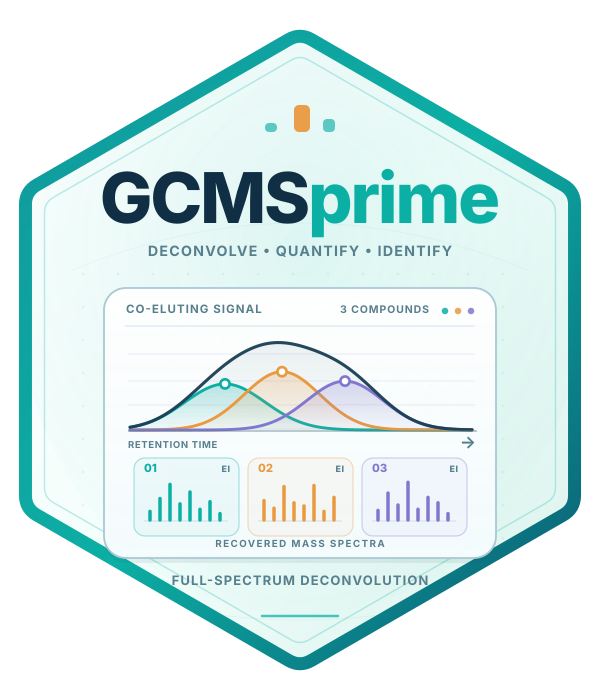

# GCMSprime: Scalable and Automated GC–MS Deconvolution, Quantification, and Spectral Library Search in R

<a href="https://tomwenseleers.github.io/GCMSprime/">
<picture>
  <source media="(prefers-color-scheme: dark)" srcset="GCMSprime/man/figures/logo-dark.svg">
  <source media="(prefers-color-scheme: light)" srcset="GCMSprime/man/figures/logo-light.svg">
  
</picture>
</a>

[Get started](https://tomwenseleers.github.io/GCMSprime/articles/gcms-deconvolution.html) · [Documentation](https://tomwenseleers.github.io/GCMSprime/reference/index.html) · [Algorithm & theory](https://tomwenseleers.github.io/L0nmf/articles/log-concave-nmf.html)

GCMSprime is a new state-of-the-art GC/MS deconvolution pipeline to separate and integrate overlapping chromatographic peaks. It enables unparalleled peak integration accuracy, and has retention index constrained library search using either public or commercial libraries built-in. It is extremely easy to use, and produces detailed sample reports in minutes in a fully automatic way, without any required user intervention or parameter settings. The deconvolution method that it uses is mathematically principled and builds on two other packages. First, [L0glm](https://tomwenseleers.github.io/L0glm/) for ultrafast joint feature selection across mass channels (approximating best subset of group selection). Second, [L0nmf](https://tomwenseleers.github.io/L0nmf/) to deconvolve spectra based on an estimated time-varying peak shape function (PSF), followed by sparse log-concave nonnegative matrix factorization with automatic best rank detection, which estimates the most parsimonious true number of compounds present, whilst allowing for flexible log-concave peak shape constraints, overdispersed multivariate Poisson noise and a smoothly varying background. In this way, the package can simultaneously estimate the number of compounds present, their elution profiles, and the deconvolved spectra, even based on data from single samples. It succeeds in accurately estimating elution profiles and peak areas, even for challenging cases where peaks are highly overloaded or have awkward shark-fin shapes, as is commonly the case for acids. To our knowledge, it is the first package that can achieve this. Following deconvolution, spectra can then be searched against public (MoNA, GCMS-ID) or commercial libraries (after Openchrom export to .MSP), using a retention index constrained seach, or be exported to NIST MS Search compatible MSP format. Using this workflow, analysts can save weeks of manual work.

## Installation

```r
install.packages("remotes")
remotes::install_github("tomwenseleers/GCMSprime/GCMSprime")
```

## Fully automatic deconvolution

```r
library(GCMSprime)
fit <- GCMSdeco("sample.cdf", "sample.msp", xlsx_file="sample.xlsx",
                alkanes_file="alkanes.cdf", precluster=32L)
fit
plot(fit, type="lines", file="sample_traces.pdf")
plot(fit, type="heatmap", file="sample_heatmaps.pdf")
plot(fit, type="profiles", file="sample_profiles_spectra.pdf")
```

The workflow calibrates a time-varying PSF, models a smooth baseline, resolves overlapping compounds and refines their spectra on every original mass channel. Results are ordered by apex retention time. MSP files are readable by NIST MS Search; Excel reports contain integrated areas and compact spectra.

## Experimental examples

The [GC/MS tutorial](https://tomwenseleers.github.io/GCMSprime/articles/gcms-deconvolution.html) includes two experimental chromatogram windows, complete fitted signals, spectra, timings and exports.


The underlying [factorization and PSF methods](https://tomwenseleers.github.io/L0nmf/) are available independently in L0nmf.

## Spectral libraries

Import MSP libraries into sparse memory or SQLite storage, preserving raw peaks, chemical identifiers, synonyms and retention-index provenance:

```r
lib <- read_msp("library.msp", backend="sqlite", db_file="library.sqlite")
spectra(lib, which=1:1000, nominal=TRUE, normalize="l2")
library_metadata(lib, which=1:10)
retention_indices(lib, which=1:1000, phase="DB5")
```

[Library formats and storage](https://tomwenseleers.github.io/GCMSprime/articles/spectral-libraries.html) covers OpenChrom MSP exports, MoNA/Golm MSP and GCMS-ID CSV predictions.

## Identify recovered compounds

Calibrate retention indices from a diagnostic-ion alkane ladder and combine column-specific RI constraints with fast spectral matching:

```r
cal <- calibrate_ri("alkanes.cdf", carbon=7:23)
identified <- identify_compounds(fit, lib, calibration=cal,
  phase="DB5", ri_tolerance=30, n_matches=5,
  method=c("stein_scott", "hellinger"),
  msp_file="sample_identified.msp", xlsx_file="sample_identified.xlsx")
```

For metric spectral distances, use `method="angular"` or `"stein_scott_angular"`.
Reusable ion-rarity weights come from `library_ion_weights(lib)` and are passed through `ion_weights=`.
Multinomial matching balances unknown reference counts to the sample total automatically.

[RI calibration and library search](https://tomwenseleers.github.io/GCMSprime/articles/library-search.html) compares five similarity measures and explains the peak-onset timing convention, retained ion totals and scalable SQLite search.

## Citation

An article describing the methods implemented in GCMSprime is in preparation.
If you use the package before the article is formally published, we would
appreciate a citation to the package:

Wenseleers T, Vanderaa C (2026).
*GCMSprime: Scalable and Automated GC–MS Deconvolution, Quantification, and Spectral Library Search in R*.
R package version 0.1.0,
<https://tomwenseleers.github.io/GCMSprime/>.

The [Authors and Citation page](https://tomwenseleers.github.io/GCMSprime/authors.html#citation) also provides the
citation in BibTeX format. Please also cite the methodological sources linked
in the help pages where relevant.

## Acknowledgements

OpenAI Codex, using GPT-6 Astra and GPT-6.1 Sol, was used to optimize and
refactor code and help draft the documentation. The key ideas and methodological
decisions are the authors' own, and the authors take full responsibility for the
work presented here.
