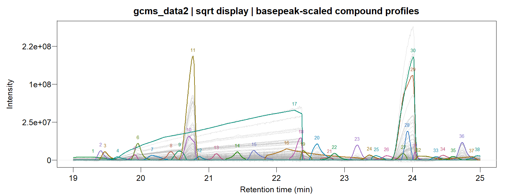

# GCMSprime

# Resolve peaks. Recover compounds.

GC/MS deconvolution, full mass spectra and reproducible chromatographic
reports.

GCMSprime is part of a focused three-package toolkit:
[L0glm](https://tomwenseleers.github.io/L0glm/) supplies fast sparse GLM
selection, [L0nmf](https://tomwenseleers.github.io/L0nmf/) supplies
sparse factorization and PSF estimation, and
[GCMSprime](https://tomwenseleers.github.io/GCMSprime/) turns those
methods into a chromatographic workflow.

## Installation

``` r

install.packages("remotes")
remotes::install_github("tomwenseleers/GCMSprime/GCMSprime")
```

## One chromatogram, complete output

``` r

library(GCMSprime)
fit <- GCMSdeco("sample.cdf", "sample.msp", xlsx_file="sample.xlsx",
                alkanes_file="alkanes.cdf", precluster=32L)
fit
plot(fit, type="lines", file="sample_traces.pdf")
plot(fit, type="heatmap", file="sample_heatmaps.pdf")
plot(fit, type="profiles", file="sample_profiles_spectra.pdf")
```

The workflow calibrates a time-varying PSF, models a smooth baseline,
resolves overlapping compounds and refines their spectra on every
original mass channel. Results are ordered by apex retention time. MSP
files are readable by NIST MS Search; Excel reports contain integrated
areas and compact spectra.

## Experimental examples

The [GC/MS
tutorial](https://tomwenseleers.github.io/GCMSprime/articles/gcms-deconvolution.md)
includes two experimental chromatogram windows, complete fitted signals,
spectra, timings and exports.


Co-eluting hydrocarbon profiles



Beer volatile profiles

The underlying [factorization and PSF
methods](https://tomwenseleers.github.io/L0nmf/) are available
independently in L0nmf.

## Spectral libraries

Import MSP libraries into sparse memory or SQLite storage, preserving
raw peaks, chemical identifiers, synonyms and retention-index
provenance:

``` r

lib <- read_msp("library.msp", backend="sqlite", db_file="library.sqlite")
spectra(lib, which=1:1000, nominal=TRUE, normalize="l2")
library_metadata(lib, which=1:10)
retention_indices(lib, which=1:1000, phase="DB5")
```

[Library formats and
storage](https://tomwenseleers.github.io/GCMSprime/articles/spectral-libraries.md)
covers OpenChrom MSP exports, MoNA/Golm MSP and GCMS-ID CSV predictions.

## Identify recovered compounds

Calibrate retention indices from a diagnostic-ion alkane ladder and
combine column-specific RI constraints with fast spectral matching:

``` r

cal <- calibrate_ri("alkanes.cdf", carbon=7:23)
identified <- identify_compounds(fit, lib, calibration=cal,
  phase="DB5", ri_tolerance=30, n_matches=5,
  method=c("stein_scott", "hellinger"),
  msp_file="sample_identified.msp", xlsx_file="sample_identified.xlsx")
```

[RI calibration and library
search](https://tomwenseleers.github.io/GCMSprime/articles/library-search.html)
compares five similarity measures and explains the peak-onset timing
convention, retained ion totals and scalable SQLite search.

## Citation and acknowledgements

An article describing these methods is in preparation. Please cite the
package and the methodological sources linked in the help pages when
using this work. OpenAI Codex/GPT-6 Astra and 6.1 Sol assisted code
optimization, refactoring and documentation; the authors developed the
key ideas and take responsibility for the work.
